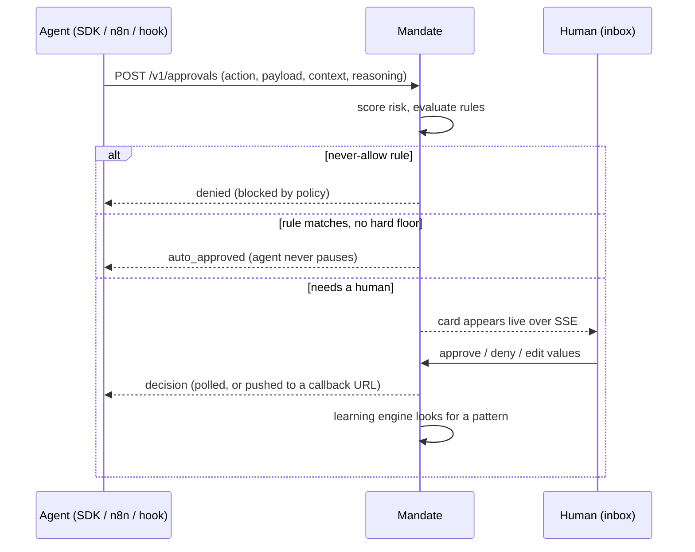

# Mandate

**The control plane for AI agents: agents ask before they act, humans approve from one inbox, and trust is earned rule by rule.**

Built for **Agentika 2.0 · NaSCon 2026 (FAST NUCES Islamabad)**. Theme: *Human + AI: Better Together*.

| | |
|---|---|
| **Live demo** | https://alternate-bright-atlas-8104-github-app.alternatefutures.ai |
| **Evaluator login** | username `demo` · password `Evaluate2026` (shared demo workspace) |
| **Demo video** | _link added at submission_ |
| **Repo** | https://github.com/aisolutionsbyhassan/mandate |

> The live site is one shared demo workspace on SQLite. Everyone who signs in sees the same inbox, and the data
> resets whenever the service redeploys. The API key the demo agents use is not published in this repo.

---

## The problem

AI agents can already draft refunds, send emails, run shell commands and delete accounts. They rarely get to do it in
production, because nobody is willing to let an agent spend money, message customers or touch data unsupervised.
The usual answers are all bad: approve every action (the agent is useless), approve none (the agent is dangerous), or
hard-code approval logic into each agent (it never gets reused).

## What Mandate does

Mandate sits between an agent and the action it wants to take.

1. **The agent asks first.** Before a risky action it calls Mandate and **blocks**.
2. **Mandate scores the risk and checks the rules humans have granted.**
   - A rule matches: the action is **auto-approved instantly** and the agent never pauses.
   - A policy says never: the action is **denied instantly**, and the agent is told it was blocked by policy.
   - Nothing matches, or a hard floor applies: the action lands in a **human inbox** with full context.
3. **A human approves, denies, or edits the values.** "Refund $9,400" can become "refund $500".
4. **The agent resumes** with that decision, using the edited values if there were any.
5. **Mandate learns.** After three similar human approvals it proposes a rule in plain English. A human grants it, and
   the agent's autonomy rises.

> **Mandate never makes a judgment call. It routes.** It enforces rules that humans granted and escalates everything
> else. The LLM only *explains* why something was flagged. It never approves or denies anything.



---

## What's in the MVP

**Routing and policy**
- Deterministic **risk score (0-100)** from irreversibility, amount, order age, blast radius, and (for coding agents)
  dangerous commands and secret files.
- **Hard floors** that always reach a human, whatever the score: any refund over $500, any account deletion,
  `rm -rf`, force pushes, `DROP TABLE`, `curl | sh`, writes to `.env`/key files.
- **Rule engine** with three actions and a fixed precedence: `never_allow` beats hard floors and `always_ask`, which
  beat `auto_approve`. Rules can be scoped to an agent or platform and can carry a **daily cap**
  (for example "auto-approve refunds under $50, up to $500 per day").
- **Plain-English to rule.** Type "never let any agent delete a customer account" and the AI drafts the rule into the
  form. A human reviews it and clicks Save. The draft is never applied on its own.

**Human side**
- Live inbox over Server-Sent Events: risk badge, "why this is flagged", the agent's own reasoning, "if this is wrong"
  impact line, a ticking timer, and **Approve / Deny / Edit & Approve**.
- Overview, connected agents, policies, history, and an autonomy meter.
- Real accounts (PBKDF2 password hashing, signed HttpOnly session cookie). Every decision shows who made it.

**Learning**
- After **3 similar human approvals** Mandate proposes a rule (for example "all under $300, all within 25 days").
  The human grants or dismisses it. Autonomy score = share of the last 50 actions handled by rules.

**Integrations (verified end to end against the deployed server)**

| Platform | How it connects | Status |
|---|---|---|
| Python agents (RefundBot demo) | `@requires_approval` SDK decorator, polls until decided | Tested |
| n8n | HTTP node + Wait node, Mandate calls back with the decision | Tested |
| Claude Code | `PreToolUse` hook (`integrations/claude_code_hook.py`) | Tested |
| Cursor | `preToolUse` hook (`integrations/cursor_hook.py`) | Tested |
| Anything with HTTP | `POST /v1/approvals`, then poll or webhook | Works; not separately tested per platform |

The in-app **Integrations** page lists 25 platforms. Only the four above are marked as natively tested. LangChain,
LangGraph, CrewAI and similar are listed as "Python SDK" because the decorator wraps any Python function, but they
have not been tested here.

---

## Quick start

### Run locally

```bash
python -m venv .venv
.venv/Scripts/activate           # Windows. On macOS/Linux: source .venv/bin/activate
pip install -r requirements.txt
cp .env.example .env             # then fill in GROQ_API_KEY and MANDATE_API_KEY
set -a; . ./.env; set +a         # load the env vars
uvicorn main:app --host 0.0.0.0 --port 8000
```

Open http://localhost:8000. On first run there are no accounts, so either set `MANDATE_ADMIN_USER` /
`MANDATE_ADMIN_PASSWORD` before starting, or use **Create account** (open signup by default).

### Run in Docker

```bash
docker build -t mandate .
docker run -p 8000:8000 --env-file .env mandate
```

The container listens on port **8000** only. No build step, no database server: SQLite is created and seeded on boot.

### Try the demo agent

```bash
export MANDATE_URL=http://localhost:8000
export MANDATE_API_KEY=<same key as the server>

python -m agents.refundbot --scenario small    # $20 refund -> auto-approved, never pauses
python -m agents.refundbot --scenario large    # $9,400 refund -> pauses for a human
python -m agents.refundbot --scenario medium   # $260 refund; approve it 3 times to see a rule proposed
```

Add `--no-llm` to skip Groq and use a scripted plan.

---

## Connect an agent

### Python (SDK)

```python
from sdk import Mandate

mandate = Mandate("https://your-mandate-url", api_key, agent_name="refundbot")

@mandate.requires_approval(action_type="issue_refund")
def issue_refund(order_id, amount, reason):
    ...  # only runs once Mandate allows it

issue_refund(order_id="4471", amount=9400, reason="damaged",
             mandate_context={"order_age_days": 94, "policy_limit_days": 30},
             mandate_reasoning="Customer reports a damaged order.")
```

Behaviour: auto-approved runs immediately · pending blocks and polls every 2 seconds · approved runs with the original
arguments · edited runs with the human's values · denied raises `ApprovalDenied` · timed out raises `ApprovalTimeout`.
It **fails closed**: if Mandate can't be reached, the function does not run.

### Any HTTP tool

```bash
curl -X POST https://your-mandate-url/v1/approvals \
  -H "x-mandate-key: $MANDATE_API_KEY" -H "content-type: application/json" \
  -d '{"agent":"my-agent","action_type":"issue_refund",
       "payload":{"amount":9400},"context":{"order_age_days":94},
       "reasoning":"why the agent wants this","callback_url":"https://example.com/resume"}'
```

The response holds `status` (`auto_approved`, `denied` or `pending`). For `pending`, either poll
`GET /v1/approvals/{id}` or pass a `callback_url` and Mandate will POST the final decision to it.

### n8n

Use an HTTP Request node to call `POST /v1/approvals` with `callback_url` set to `{{ $execution.resumeUrl }}`, route on
`status`, and put a **Wait** node on the pending branch. When a human decides, Mandate POSTs the decision to the resume
URL and the workflow continues. Authenticate with a Header Auth credential (`x-mandate-key`).

### Claude Code

Download the hook from your Mandate server and register it:

```bash
mkdir -p .claude/hooks
curl -o .claude/hooks/mandate_hook.py https://your-mandate-url/integrations/claude_code_hook.py
```

`.claude/settings.json`:

```json
{
  "env": { "MANDATE_URL": "https://your-mandate-url", "MANDATE_API_KEY": "<agent key>" },
  "hooks": { "PreToolUse": [{
    "matcher": "Bash|Write|Edit|MultiEdit",
    "hooks": [{ "type": "command", "timeout": 600,
                "command": "python \"$CLAUDE_PROJECT_DIR/.claude/hooks/mandate_hook.py\"" }]
  }]}
}
```

Read-only commands (`ls`, `git status`) are auto-approved by a seeded rule. A denial tells Claude a human said no, so it
stops and asks you instead of retrying another way. If Mandate is unreachable, the hook falls back to Claude Code's
normal permission prompt.

### Cursor

`integrations/cursor_hook.py` uses Cursor's `preToolUse` hook (matcher `Shell|Write|Delete`). Put the URL and key in
`.cursor/hooks/mandate.json` (`{"url": "...", "api_key": "..."}`) or in environment variables. Cursor does not honour an
"ask" answer from this hook, so if Mandate is unreachable the hook **denies** (fail closed). On Windows use the full
path to `python.exe` in `hooks.json`.

The in-app **Integrations → Connect** wizard generates these snippets with your server's URL filled in.

---

## How the decision is made

1. `score_risk` computes the 0-100 score and any hard floor from the action and its context.
2. `evaluate` finds every active rule that matches, then applies this precedence:
   **never-allow → (hard floor or always-ask) → auto-approve → human**.
3. An auto-approve rule with a daily cap is skipped once the cap would be exceeded, and the reason is shown to the human.
4. Only if the action is going to a human does the LLM (Groq, `openai/gpt-oss-120b`) write the "why flagged" bullets and
   the "if this is wrong" line, with a 3-second timeout. On any failure (timeout, rate limit, bad JSON) the reasons are
   built from the deterministic signals instead. An LLM failure never blocks or crashes a request.

A rule is `{action_type, agent, source, daily_cap, conds: [{field, op, value}]}` with operators `lt`, `lte`, `gt`, `gte`,
`eq`, `neq`, `contains`, `not_contains`, `matches` (glob) and `is_read_only`.

---

## Architecture

One container, one process, one SQLite file.

```
main.py                    FastAPI app: REST API, SSE, auth, serves the single page
core.py                    SQLite, risk scoring, rule engine, learning engine, seed data
sdk.py                     @requires_approval decorator for Python agents
agents/refundbot.py        Demo support agent (Groq tool calling, scripted fallback)
integrations/              Claude Code and Cursor hook scripts (standard library only)
templates/app.html         The whole UI: Jinja2 + vanilla JS + hand-written CSS (no build step)
Dockerfile                 python:3.11-slim, EXPOSE 8000
```

Deliberate choices: no ORM, no Redis, no Postgres, no React, no CSS framework, no LangChain. The dependencies are
FastAPI, Uvicorn, Jinja2, httpx and the Groq client, which keeps the container build fast.

### API

| Route | Purpose |
|---|---|
| `POST /v1/approvals` | An agent asks. Returns `{id, status, risk_score, risk_reasons, rule_id, decided_by}` |
| `GET /v1/approvals/{id}` · `GET /v1/approvals?status=pending` | Poll or list |
| `POST /v1/decide/{id}` | Human decision: `approved`, `denied` or `edited` (with `final_payload`) |
| `GET /v1/policies` · `POST/PUT/DELETE /v1/policies...` | Rules, proposals, autonomy score |
| `POST /v1/policies/draft` | Plain English to a draft rule (not saved) |
| `POST /v1/policies/{id}/grant` · `/dismiss` | Accept or reject a proposed rule |
| `GET /v1/agents` | Connected agents with action counts and autonomy |
| `GET /events` | SSE stream of new approvals and decisions |
| `POST /demo/reset` | Wipe and reseed data (keeps accounts) |
| `GET /health` | `{"status":"ok","service":"mandate"}` |

### Configuration

| Variable | Purpose |
|---|---|
| `MANDATE_API_KEY` | **Required.** The key agents send in the `x-mandate-key` header |
| `GROQ_API_KEY` | Optional. Enables AI explanations and plain-English rule drafting. Without it, the deterministic fallback is used |
| `GROQ_MODEL` | Optional. Defaults to `openai/gpt-oss-120b` |
| `MANDATE_ADMIN_USER` / `_PASSWORD` / `_NAME` | Create an owner account on every boot (SQLite resets on redeploy) |
| `MANDATE_DEMO_USER` / `_PASSWORD` / `_NAME` | Create a shared evaluator login and show it on the sign-in page |
| `MANDATE_REQUIRE_INVITE=1` | Make signup require an invite code (shown in the account menu) |
| `MANDATE_SESSION_SECRET` | Separate secret for session cookies (defaults to `MANDATE_API_KEY`) |
| `MANDATE_DB` | SQLite path (defaults to `mandate.db`) |

---

## Honest limits of this MVP

This was built in a hackathon window, and it is a working proof of the idea, not a hardened product.

- **One shared workspace.** There is no per-user or per-team data isolation. Accounts identify who decided; they do not
  partition data. The demo site is deliberately one shared workspace.
- **SQLite on an ephemeral container.** Data, including accounts and learned rules, resets on every redeploy. Accounts
  and demo logins are recreated from environment variables on boot.
- **One shared agent API key**, stored as an environment variable. Signed-in users can see it in the Connect wizard.
  There are no per-agent keys, rotation or scopes yet.
- **Command rules are text matching.** A rule like "never touch `config/payments`" is enforced on the command string.
  During testing a shell heredoc bypassed a file-write rule, which we closed with a second rule. A determined agent
  could still find other routes.
- **LLM explanations are best-effort.** On the deployed server the Groq call succeeded about half the time in our tests.
  The deterministic fallback text always appears when it fails. The LLM never affects the decision.
- **Tested by the team, on a small set of scenarios.** Claude Code and Cursor were tested with real sessions on a few
  prompts. There is no automated test suite.
- **Not built:** Slack or email approvals with one-click links, Make and Zapier blueprints, multi-approver flows.

---

## What the final product could be

- **Real multi-tenancy:** workspaces and teams on Postgres, with roles (viewer, approver, admin), SSO, and an audit log
  that can be exported.
- **Per-agent credentials:** scoped, hashed, rotatable API keys created inside the app, instead of one shared key.
- **Approve from anywhere:** Slack, Teams, email and mobile push with signed one-click links, plus escalation chains and
  multi-approver rules for large amounts.
- **A gateway for agent tools:** an MCP / tool-call proxy so any agent framework is governed without adding code, and
  first-class LangGraph, CrewAI and Make/Zapier integrations.
- **Richer, org-specific risk:** budgets per team and per day, anomaly detection on an agent's behaviour, and policy
  versioning with review and rollback ("policy as code").
- **Time-boxed delegation:** "let this agent do X for the next hour", with automatic revocation, and autonomy trends per
  agent over time.
- **Deployment options:** managed cloud, or self-hosted for teams that cannot send agent traffic outside their network.

---

## Team and credits

Built by [@aisolutionsbyhassan](https://github.com/aisolutionsbyhassan) for Agentika 2.0, NaSCon 2026.
Hosted on Clouds by Alternate Futures. Explanations powered by Groq.
